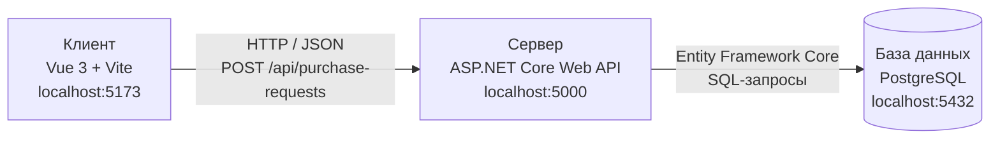

# Архитектура информационной системы «Товароучёт»

## 1. Назначение архитектуры

В рамках ЛР2 фиксируется трёхузловая архитектура web-ИС для процесса управления заявками на закупку материалов. Пользователь работает с интерфейсом Vue 3. Интерфейс отправляет HTTP-запросы в ASP.NET Core Web API. Сервер проверяет права и бизнес-правила, после чего обращается к PostgreSQL через Entity Framework Core.

## 2. Схема из трёх узлов



**архитектура web-ИС семестра**

## 3. Ответственность узлов

| Узел | Технологии | Ответственность |
|---|---|---|
| Клиент | Vue 3, Vite, TypeScript | Отображает список и форму заявок, отправляет HTTP-запросы, показывает ответы и сообщения об ошибках. |
| Сервер | ASP.NET Core Web API, C# | Принимает запросы, проверяет входные данные, аутентификацию, права пользователя и допустимость действий с заявками. |
| База данных | PostgreSQL | Хранит заявки, номенклатуру, пользователей и связанные данные. |

## 4. Пример взаимодействия

При создании заявки браузер отправляет серверу запрос:

```http
POST /api/purchase-requests
Content-Type: application/json
```

```json
{
  "title": "Закупить листовой металл",
  "materialId": 12,
  "description": "Материал необходим для выполнения производственного заказа."
}
```

Сервер проверяет, что пользователь имеет право создавать заявки, что материал существует и не находится в архиве, а заголовок и описание соответствуют ограничениям. Затем сервер сохраняет заявку в PostgreSQL и возвращает ответ `201 Created` с созданной записью.

## 5. Почему браузер не подключается к PostgreSQL напрямую

Прямого соединения между браузером и PostgreSQL нет. Браузер не должен получать строку подключения и самостоятельно выполнять SQL-запросы. Все обращения к данным проходят через ASP.NET Core. Это позволяет централизованно проверять права пользователей, валидировать данные, применять бизнес-правила и контролировать изменения.

## 6. Порты и соответствие текущему проекту

В схеме указаны порты, требуемые методичкой ЛР2:

- Vue/Vite — `5173`;
- ASP.NET Core — `5000`;
- PostgreSQL — обычно `5432`.

В приложенном проекте `site02` README сейчас указывает адрес backend `http://localhost:5080`. В описании локального кластера PostgreSQL также указан порт `5433`, тогда как Docker-конфигурация может использовать стандартный `5432`. Для сдачи ЛР2 схема оставлена с учебными портами из методички (`5000` и `5432`). При последующей настройке запуска фактические порты должны быть согласованы с конфигурацией проекта.

## 7. Граница ответственности

Vue отвечает за отображение и взаимодействие с пользователем. ASP.NET Core является единственной точкой доступа к данным и местом проверки правил. PostgreSQL обеспечивает постоянное хранение данных. Клиент не обращается к базе напрямую.
