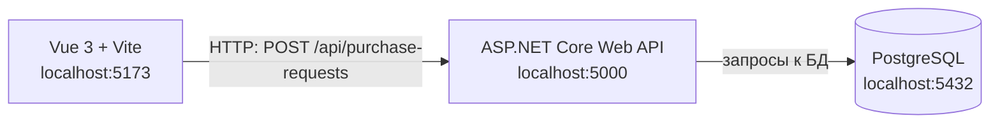

# Архитектура системы управления заявками на закупку материалов

Курс: Б1.В.ДЭ.01.02.02 · КГЭУ · семестр 1 · 2026/2027
Студент: Абдуллина Алия Илдаровна · Группа: ТРИС-3-23
Лабораторная работа 2. Основание: [`lab-01-requirements.md`](lab-01-requirements.md)

Документ описывает проектное решение. Кода клиента и сервера на этапе ещё нет.

## 1. Схема из трёх узлов



> архитектура web-ИС семестра

Та же схема текстом:

```text
Vue 3 + Vite             ASP.NET Core Web API       PostgreSQL
localhost:5173  ───────► localhost:5000   ───────►  localhost:5432
                  HTTP                    запросы к БД
```

На схеме три узла и две связи. Прямой связи браузера с базой данных нет.

## 2. Назначение узлов

| Узел | Адрес | Что делает | Чего не делает |
|---|---|---|---|
| Клиент: Vue 3 + Vite | `localhost:5173` | показывает три экрана (список заявок, создание заявки, вход), проверяет поля для удобства пользователя, отправляет HTTP-запросы и показывает ответы | не хранит общие данные и не решает окончательно, разрешено ли действие |
| Сервер: ASP.NET Core Web API | `localhost:5000` | принимает запросы, проверяет поля, права и правила статусов, выдаёт `id` и `number`, формирует ответы и коды | не отвечает за отображение экранов |
| База данных: PostgreSQL | обычно `localhost:5432` | хранит заявки, материалы и пользователей, сохраняет данные после перезапуска сервера (НФТ-1) | не принимает запросы от браузера |

## 3. Компоненты системы

| Узел | Компонент | Ответственность |
|---|---|---|
| Клиент | Экран списка заявок | показывает номер, заголовок, материал, исполнителя и статус (ФТ-12) |
| Клиент | Экран создания заявки | собирает `title`, `materialId`, `description`, показывает ошибки (ФТ-1, ФТ-2, ФТ-3) |
| Клиент | Экран входа | принимает логин и пароль |
| Клиент | Модуль обращения к API | единственное место, которое знает адрес сервера |
| Сервер | Контроллер заявок | принимает HTTP-запрос и возвращает ответ с кодом |
| Сервер | Сервис заявок | содержит правила: кто что может и какие переходы статуса разрешены (ФТ-6 — ФТ-11) |
| Сервер | Слой доступа к данным | читает и записывает строки PostgreSQL |
| База данных | Таблицы заявок, материалов, пользователей | см. [`data-model.md`](data-model.md) |

Способ входа в систему (cookie или JWT) выбирается в ЛР11. На схему и модель данных этот выбор не влияет.

## 4. Пример прохождения запроса

Сотрудник отдела снабжения нажимает «Создать». Клиент отправляет запрос:

```http
POST http://localhost:5000/api/purchase-requests
Content-Type: application/json

{
  "title": "Закупка алюминиевого листа",
  "materialId": 2,
  "description": "Требуется лист для партии кастрюль на следующий месяц"
}
```

Значения в примере демонстрационные и не являются утверждёнными справочными данными.

1. **Vue → ASP.NET Core.** Браузер передаёт только три поля, заполненные человеком.
2. **ASP.NET Core.** Сервер проверяет поля и право пользователя создавать заявку, затем задаёт `id`, `number` и статус `New`.
3. **ASP.NET Core → PostgreSQL.** Сервер записывает строку заявки.
4. **Ответ.** Клиент получает код `201` и созданную заявку; пример ответа приведён в [`api-contract.md`](api-contract.md).

## 5. Почему браузер не обращается к PostgreSQL напрямую

- **Правила обходились бы.** Проверки и права доступа работают на сервере. Прямой доступ позволил бы специалисту изменить чужую заявку, что запрещает ФТ-10.
- **Секреты стали бы доступны.** Для подключения к базе браузеру понадобился бы пароль, а код клиента может прочитать любой пользователь (НФТ-3).
- **Источник правды один.** Все пользователи видят одно состояние заявки, потому что читают и меняют его через один сервер.
