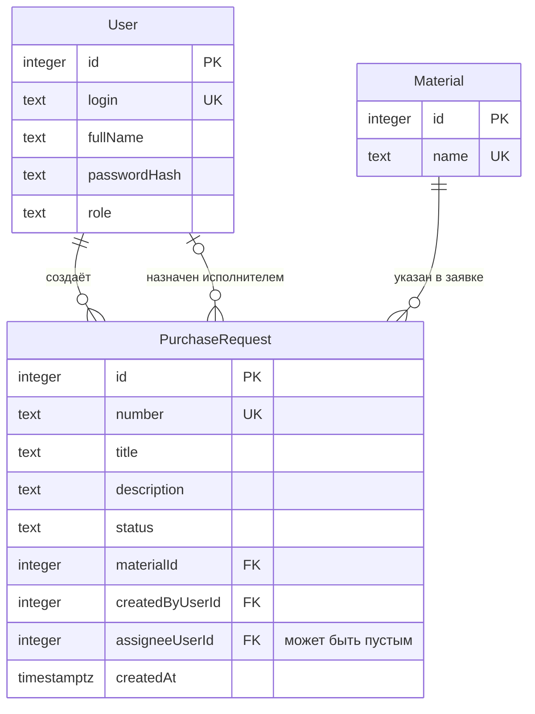
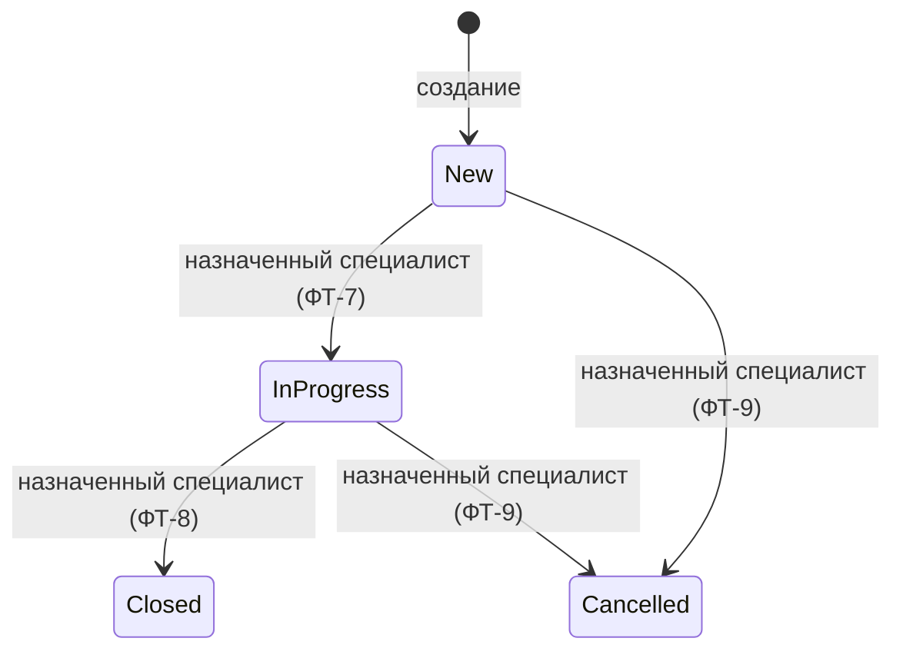

# Модель данных системы управления заявками на закупку материалов

Курс: Б1.В.ДЭ.01.02.02 · КГЭУ · семестр 1 · 2026/2027
Студент: Абдуллина Алия Илдаровна · Группа: ТРИС-3-23
Лабораторная работа 2. Основание: [`lab-01-requirements.md`](lab-01-requirements.md), [`project-proposal.md`](project-proposal.md)

## 1. Словарь проекта

Эти имена используются во всех документах и в будущем коде.

| Термин курса | Термин проекта | Имя в модели |
|---|---|---|
| Ticket (главный объект) | заявка на закупку материала | `PurchaseRequest` |
| Site (справочник) | материал | `Material` |
| `siteId` | ссылка на материал | `materialId` |
| User | пользователь | `User` |
| Кто создаёт (диспетчер) | сотрудник отдела снабжения | роль `SupplyEmployee` |
| Кого назначают (инженер) | специалист по закупкам | роль `PurchasingSpecialist` |
| Кто смотрит сводку (руководитель) | руководитель отдела снабжения | роль `SupplyManager` |

Коды ролей введены на этом этапе 

## 2. ER-диаграмма

### Связи словами

- **Один материал — много заявок.** Заявка ссылается ровно на один материал; материал может не встречаться ни в одной заявке.
- **Один пользователь создаёт много заявок.** У каждой заявки ровно один создатель.
- **Один пользователь может быть назначен на много заявок.** У заявки ноль или один исполнитель: сразу после создания исполнитель отсутствует.

## 3. Сущности

В таблицах указаны имена из JSON и C#. В SQL те же поля будут в `snake_case`: `material_id`, `created_by_user_id`, `assignee_user_id`, `created_at`, `full_name`, `password_hash`.

### 3.1. `PurchaseRequest` — заявка на закупку материала

Главный объект. Одна запись описывает одну потребность в закупке материала.

| Поле | Тип | Ключ | Обязательно | Кто задаёт | Назначение |
|---|---|---|---|---|---|
| `id` | integer | PK | да | сервер | машинный идентификатор, используется в адресе API |
| `number` | text | UNIQUE | да | сервер | человеческий номер; демонстрационный пример: `ЗК-117` |
| `title` | text, 5–80 символов | | да | клиент | заголовок заявки |
| `description` | text, 10–500 символов | | да | клиент | описание потребности |
| `status` | text | | да | сервер | `New`, `InProgress`, `Closed` или `Cancelled`; при создании `New` |
| `materialId` | integer > 0 | FK → `Material.id` | да | клиент | материал заявки |
| `createdByUserId` | integer | FK → `User.id` | да | сервер | вошедший пользователь, создавший заявку |
| `assigneeUserId` | integer | FK → `User.id` | **нет** | сервер по отдельному запросу | назначенный специалист; при создании пусто |
| `createdAt` | timestamptz | | да | сервер | момент создания; нужен для сортировки списка |

`id` и `number` — разные поля. `id` нужен программе и не меняется; `number` нужен людям, чтобы называть заявку в разговоре и в списке.

### 3.2. `Material` — справочник материалов

| Поле | Тип | Ключ | Обязательно | Назначение |
|---|---|---|---|---|
| `id` | integer | PK | да | машинный идентификатор, на него ссылается `materialId` |
| `name` | text | UNIQUE | да | название материала; хранится только здесь |

### 3.3. `User` — пользователь

| Поле | Тип | Ключ | Обязательно | Назначение |
|---|---|---|---|---|
| `id` | integer | PK | да | машинный идентификатор |
| `login` | text | UNIQUE | да | логин для входа |
| `fullName` | text | | да | имя для показа исполнителя в списке (ФТ-12) |
| `passwordHash` | text | | да | hash пароля; сам пароль не хранится (НФТ-3) |
| `role` | text | | да | `SupplyEmployee`, `PurchasingSpecialist` или `SupplyManager` |

Роль хранится полем пользователя: у пользователя одна роль, а других сведений о ролях нет, поэтому отдельная сущность не нужна.

## 4. Статусы и переходы

| Код | Подпись на экране | Смысл |
|---|---|---|
| `New` | Новая | заявка создана |
| `InProgress` | В работе | назначенный специалист взял заявку |
| `Closed` | Закупка завершена | обработка завершена |
| `Cancelled` | Отменена | закупка больше не требуется |

### Основание правил

| Правило | Статус | Основание |
|---|---|---|
| Назначение меняет только `assigneeUserId` и не меняет `status` | обязательное | ФТ-6, критерий 2 |
| Перевод в `InProgress` выполняет только назначенный специалист | обязательное | ФТ-7, ФТ-10, критерий 3 |
| Перевод в `InProgress` без исполнителя запрещён | обязательное | методичка ЛР8 |
| Назначенный специалист может отменить свою заявку | обязательное | ФТ-9 |
| Отмена возможна из `New` и `InProgress` | проектное решение | ФТ-9 не называет исходный статус |
| Из `Closed` и `Cancelled` переходов нет | проектное решение | таких переходов нет в ЛР1 |
| Назначение возможно только в статусе `New` | проектное решение | критерий 2 описывает только `New` |
| Пока заявка в `New`, исполнителя можно заменить | проектное решение | не описывает замену |

## 5. Проверка третьей нормальной формы (3НФ)

Название материала хранится в сущности `Material` один раз. `PurchaseRequest` содержит внешний ключ `materialId`. При переименовании материала меняется одна строка, поэтому текст названия не дублируется в заявках.

Проверка по сущностям:

- **`PurchaseRequest`.** Каждое поле описывает саму заявку и зависит только от `id`. Название материала и имена пользователей в заявке не хранятся: вместо них используются `materialId`, `createdByUserId` и `assigneeUserId`. Значит, транзитивных зависимостей нет.
- **`Material`.** `name` зависит только от `id`.
- **`User`.** `login`, `fullName`, `passwordHash` и `role` зависят только от `id`.

Составных ключей нет, поэтому частичных зависимостей тоже нет. Модель находится в 3НФ.

Ответы API включают `materialName` и `assigneeFullName` (см. [`api-contract.md`](api-contract.md)), но эти значения сервер получает из связанных таблиц при чтении и в заявке не хранит.

## 6. Что сознательно не входит в модель

По разделу 7 заявки на тему в текущем семестре не реализуются: количество, единица измерения, требуемая дата и приоритет заявки; история изменений; складские остатки; поставщики. Новые сущности для них будут добавляться отдельно и не потребуют менять смысл существующих связей.
