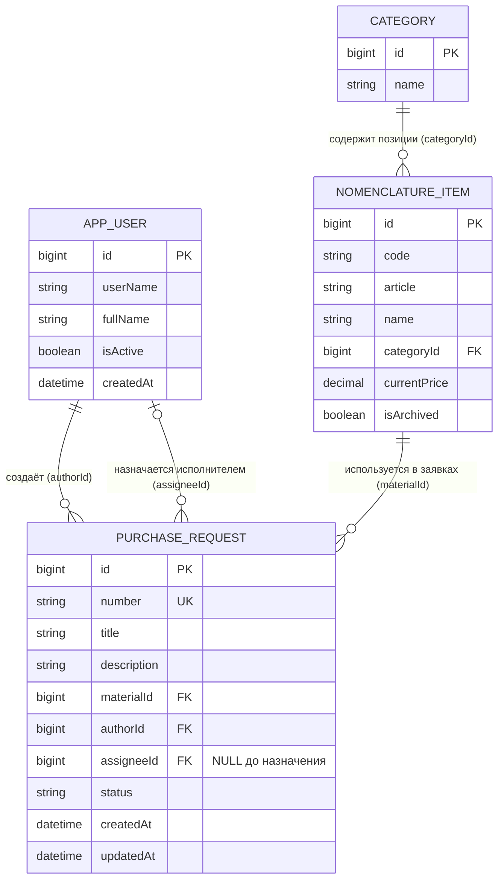
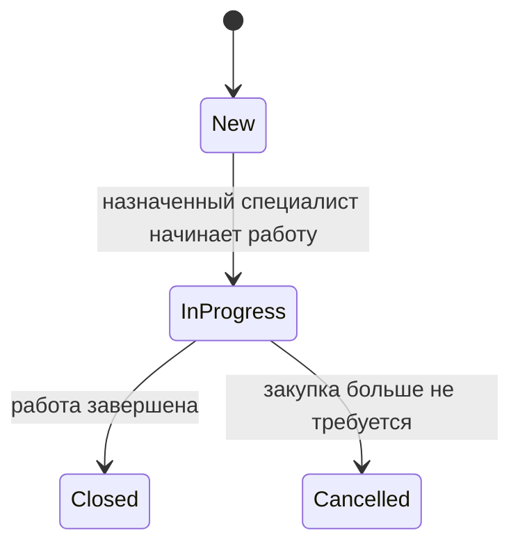

# Модель данных системы «Товароучёт»

## 1. Словарь предметной области

| Термин курса | Термин проекта |
|---|---|
| Ticket — главный объект | PurchaseRequest — заявка на закупку материала |
| Site — справочник | NomenclatureItem — позиция справочника номенклатуры, используемая как материал заявки |
| User — пользователь | AppUser — пользователь системы |
| siteId | materialId |
| createdByUserId | authorId |
| assigneeUserId | assigneeId |

В документах и API используется единое название `PurchaseRequest`. В текущем коде проекта главная сущность называется `PurchaseRequest`, справочник материалов является частью общего справочника `NomenclatureItem`, а пользователь представлен сущностью `AppUser`.

## 2. Основные сущности и атрибуты

### 2.1. PurchaseRequest — заявка на закупку

| Поле | Тип / обязательность | Ключ | Назначение |
|---|---|---|---|
| `id` | bigint, обязательно | PK | Технический идентификатор заявки |
| `number` | varchar, обязательно, уникально | — | Человекочитаемый номер, например `ЗК-0001` |
| `title` | varchar(5–80), обязательно | — | Краткий заголовок заявки |
| `description` | varchar(10–500), обязательно | — | Описание потребности в материале |
| `materialId` | bigint, обязательно | FK | Ссылка на позицию номенклатуры |
| `authorId` | bigint, обязательно | FK | Ссылка на пользователя, создавшего заявку |
| `assigneeId` | bigint, допускает NULL | FK | Ссылка на назначенного специалиста |
| `status` | enum/string, обязательно | — | Состояние заявки |
| `createdAt` | timestamp, обязательно | — | Дата создания |
| `updatedAt` | timestamp, обязательно | — | Дата последнего изменения |

`id` и `number` имеют разное назначение. `id` — внутренний первичный ключ, используемый для связей и адресов API. `number` — удобный номер, который показывается пользователю. В проекте номер формируется с префиксом `ЗК` и последовательностью PostgreSQL.

### 2.2. NomenclatureItem — позиция справочника номенклатуры

| Поле | Тип / обязательность | Ключ | Назначение |
|---|---|---|---|
| `id` | bigint, обязательно | PK | Идентификатор позиции номенклатуры |
| `code` | varchar, обязательно | — | Код позиции |
| `article` | varchar, обязательно | — | Артикул |
| `name` | varchar, обязательно | — | Наименование материала |
| `categoryId` | bigint, обязательно | FK | Ссылка на категорию номенклатуры |
| `currentPrice` | decimal, допускает NULL | — | Текущая цена |
| `isArchived` | boolean, обязательно | — | Признак нахождения в архиве |
| `createdAt` | timestamp, обязательно | — | Дата создания |
| `updatedAt` | timestamp, обязательно | — | Дата изменения |

Для заявки используется уже существующая в проекте позиция `NomenclatureItem`. Отдельная дублирующая таблица материалов для ЛР2 не вводится.

### 2.3. AppUser — пользователь системы

| Поле | Тип / обязательность | Ключ | Назначение |
|---|---|---|---|
| `id` | bigint, обязательно | PK | Идентификатор пользователя |
| `userName` | string, обязательно | — | Логин пользователя (поле ASP.NET Core Identity) |
| `fullName` | string, обязательно | — | ФИО пользователя |
| `isActive` | boolean, обязательно | — | Признак активности учётной записи |
| `createdAt` | timestamp, обязательно | — | Дата создания учётной записи |

`AppUser` основан на ASP.NET Core Identity и дополнительно содержит сведения, необходимые приложению. Роли пользователей хранятся средствами Identity отдельно от заявки.

### 2.4. Category — категория номенклатуры (связанная сущность проекта)

В существующем проекте у `NomenclatureItem` есть внешний ключ `categoryId` на справочник `Category`. Категория нужна для организации общей номенклатуры. Она является вспомогательной сущностью существующей системы и не заменяет справочник материалов в заявке.

| Поле | Тип / обязательность | Ключ | Назначение |
|---|---|---|---|
| `id` | bigint, обязательно | PK | Идентификатор категории |
| `name` | string, обязательно | — | Название категории |

## 3. ER-диаграмма

### Связи словами

1. Одна позиция номенклатуры может быть указана во многих заявках. Каждая заявка ссылается на одну позицию через `materialId`.
2. Один пользователь может создать много заявок. Каждая заявка имеет одного автора через `authorId`.
3. Один пользователь может быть назначен исполнителем многих заявок. У заявки может быть ноль или один исполнитель через `assigneeId`.
4. Одна категория может включать много позиций номенклатуры. Каждая позиция относится к одной категории через `categoryId`.

`assigneeId` допускает `NULL`, потому что сразу после создания заявка ещё не назначена специалисту.

## 4. Статусы и допустимые переходы

Используются четыре кода статуса:

- `New` — новая;
- `InProgress` — в работе;
- `Closed` — закрыта;
- `Cancelled` — отменена.

Назначение исполнителя — отдельное действие. Оно не меняет статус. Назначить или переназначить исполнителя можно только пока заявка имеет статус `New`. Статус меняет только назначенный специалист, причём только в рамках разрешённых переходов.

Удаление заявки через `DELETE` не предусматривается. Отмена фиксируется статусом `Cancelled`, запись остаётся в базе данных.

## 5. Проверка третьей нормальной формы (3НФ)

Наименование материала хранится в сущности `NomenclatureItem` один раз. В заявке `PurchaseRequest` хранится только внешний ключ `materialId`, а не текстовое название материала. При изменении наименования материала достаточно изменить одну запись справочника, и все связанные заявки будут ссылаться на актуальную позицию. Аналогично, ФИО автора и исполнителя хранятся в `AppUser`, а в заявке находятся только `authorId` и `assigneeId`. Название категории хранится в `Category`, а в позиции номенклатуры — только `categoryId`. Такое разделение не дублирует справочные сведения в каждой заявке и соответствует принятой в рамках ЛР2 проверке 3НФ.

## 6. Почему нужны отдельные id и number

`id` — машинный первичный ключ, по которому таблицы связываются между собой и к которому обращается API. `number` — уникальный понятный пользователю номер заявки, например `ЗК-0001`. Номер не используется вместо первичного ключа, потому что его формат предназначен для отображения, а не для организации связей между таблицами.
